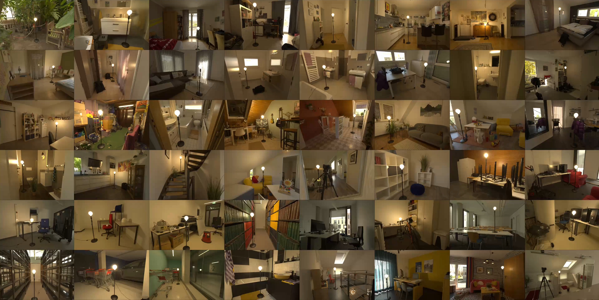

<h3 align="center">3D-anchored Light Probes (3DLP)</h3>

<hr>

<p align="center">
  <picture>
    <source media="(prefers-color-scheme: dark)" srcset="docs/assets/title-dark.svg">
    
  </picture>
</p>

<p align="center">
  <a href="https://scholar.google.com/citations?user=6Z_CcEsAAAAJ">Tim Küchler</a><sup>1,3,*</sup> &nbsp;·&nbsp;
  <a href="https://scholar.google.com/citations?user=fV6PWhQAAAAJ">Johann-Friedrich Feiden</a><sup>1,*</sup> &nbsp;·&nbsp;
  <a href="https://niessnerlab.org/members/matthias_niessner/profile.html">Matthias Nießner</a><sup>2</sup> &nbsp;·&nbsp;
  <a href="https://hci.iwr.uni-heidelberg.de/vislearn/people/carsten-rother/">Carsten Rother</a><sup>1</sup>
</p>

<p align="center">
  <sup>1</sup> Heidelberg University &nbsp;·&nbsp;
  <sup>2</sup> Technical University of Munich &nbsp;·&nbsp;
  <sup>3</sup> Zuse School ELIZA<br>
  <sup>*</sup> Equal contribution
</p>

<p align="center">
  <picture>
    <source media="(prefers-color-scheme: dark)" srcset="docs/assets/spotlight-dark.svg">
    
  </picture>
</p>

<p align="center">
  <a href="https://tim-kuechler.github.io/3DLP/"></a>
  <a href="https://arxiv.org/abs/2606.26738"></a>
  <a href="https://huggingface.co/datasets/timkuechler/3DLP"></a>
  <a href="https://www.youtube.com/watch?v=sWxcv2XGi6M"></a>
</p>

**3DLP** evaluates how accurately image editing models reproduce real-world
lighting changes. Models turn a visible light probe **on** or **off**, and their
edits are compared with HDR captures of the same scene in the target state.



## Dataset and metrics

The [dataset](https://huggingface.co/datasets/timkuechler/3DLP) contains **1,000 HDR
image pairs** for the main benchmark, material and lighting-effect masks, JPEG
previews, and **479 additional pairs** for ambient-light and light-type ablations.

Evaluation compares predicted and measured lighting ratios using two
lower-is-better scores: **Standardised Intensity Error (SIE)** for spatial
intensity structure, and **Low-Frequency Error (LFE)** for light falloff and
shading. Both compensate for global photographic changes. See the
[project page](https://tim-kuechler.github.io/3DLP/) for results and comparisons.

## Quick start

Use **Python 3.11 or newer**, from the repository root:

```bash
python -m pip install -r requirements.txt
```

Export sRGB PNG inputs for both editing tasks:

```bash
python -m threedlp.data.export_3dlp_generation_inputs \
  --output-root ./3dlp_generated \
  --states on off
```

The first run downloads the main HDR subset from Hugging Face. For a smaller
export, add `--limit 5`; this does not limit the dataset download.
OFF-image EXIF correction is enabled by default for export and disabled by
default for evaluation; use `--no-correct-off-img` or `--correct-off-img` to override.

Run your editing model externally on each `input_path` in
`3dlp_generated/manifest.jsonl`. Its `target_state` specifies the desired edit.
Save each output at `generated_path_template`, replacing `{model_name}` with
`my_model`. Use RGB PNG, JPG, or JPEG images with the same scene framing.

Evaluate your outputs:

```bash
python -m threedlp.benchmark.calculate_benchmark \
  --generated-root-dir ./3dlp_generated \
  --models my_model \
  --tasks turn_on turn_off \
  --output-csv results/my_model_3dlp.csv \
  --max-cores 8
```

The CSV reports SIE, LFE, and valid-image counts per model and task. Check coverage
before comparing results. The [workflow guide](docs/workflow.md) covers output
layouts, generation examples, and optional analyses;
[the internals guide](docs/internals.md) explains the implementation. All commands
support `--help`.

## Citation

```bibtex
@misc{kuchler2026imageeditingmodelsunderstand,
  title={Do Image Editing Models Understand Lighting?},
  author={Tim K{\"u}chler and Johann-Friedrich Feiden and Matthias Nie{\ss}ner and Carsten Rother},
  year={2026},
  eprint={2606.26738},
  archivePrefix={arXiv},
  primaryClass={cs.CV},
  url={https://arxiv.org/abs/2606.26738}
}
```

## License

Code is released under the [MIT License](LICENSE).
